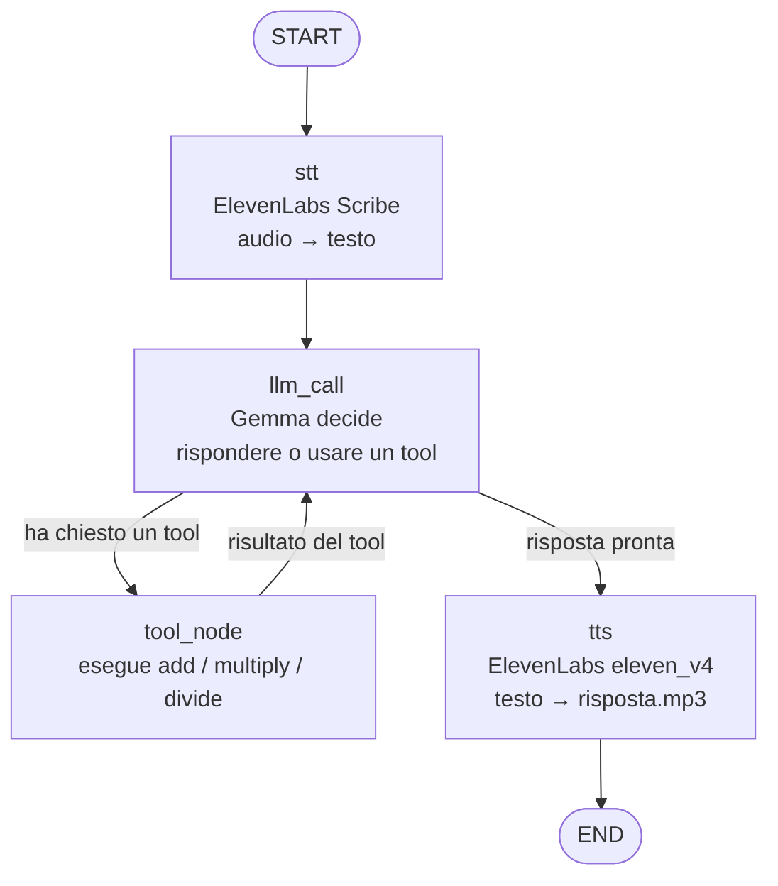

# Flusso della calcolatrice vocale

Esempio: l'utente registra "quanto fa tre più quattro" in `domanda.mp3`.



## Passo per passo

| # | Nodo        | Entrata                         | Uscita                                   | Chiamata esterna   |
|---|-------------|---------------------------------|------------------------------------------|--------------------|
| 1 | `stt`       | `audio_in` = `domanda.mp3`      | `question` + primo `HumanMessage`        | ElevenLabs STT     |
| 2 | `llm_call`  | tutti i `messages`              | un `AIMessage` (testo o tool call)       | Gemma (Google API) |
| 3 | `tool_node` | `tool_calls` dell'ultimo AI     | `ToolMessage` con il risultato           | nessuna            |
| 4 | `tts`       | testo dell'ultimo `AIMessage`   | `answer` + `audio_out` = `risposta.mp3`  | ElevenLabs TTS     |

Nell'esempio "tre più quattro", i messaggi crescono così:

```
HumanMessage("quanto fa tre più quattro")        ← stt
AIMessage(tool_calls=[add(a=3, b=4)])            ← llm_call (1ª chiamata)
ToolMessage("7")                                 ← tool_node
AIMessage("Tre più quattro fa sette.")           ← llm_call (2ª chiamata) → tts → END
```

## Dove stanno le idee di LangGraph

- **Stato** (`CalcState`): la memoria condivisa. `messages` usa `operator.add`, quindi ogni nodo *aggiunge* messaggi invece di sostituirli.
- **Nodi**: funzioni `stato → aggiornamento parziale`.
- **Archi fissi**: `add_edge`, sempre lo stesso percorso.
- **Archi condizionali**: `add_conditional_edges` + `should_continue`, il percorso dipende dallo stato.
- **Ciclo**: `tool_node → llm_call`, che rende possibili più tool call in sequenza.
